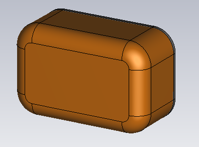
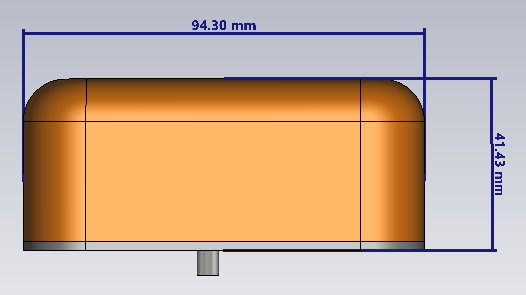
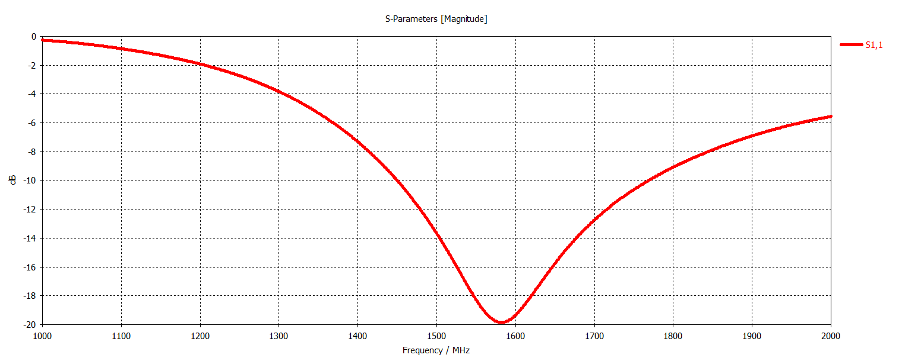
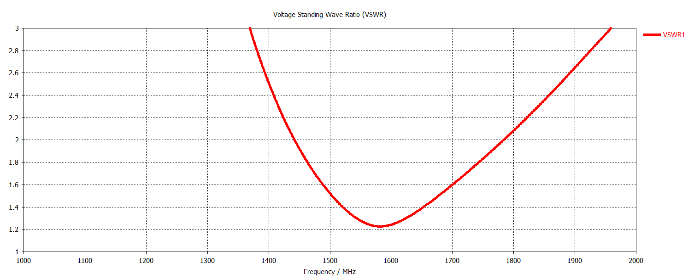
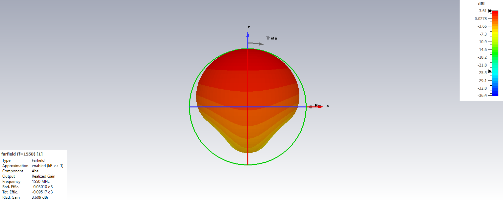

# L-Band Hemi-Omnidirectional Antenna

## Overview

This design presents an L-band hemi-omnidirectional antenna developed and analyzed using CST Studio Suite.

The antenna is linearly polarized and was optimized for operation over the 1550–1620 MHz frequency range. Although the antenna exhibits a broader impedance bandwidth, the design optimization was focused on maintaining a VSWR below approximately 1.3:1 throughout the target operating band.

The antenna provides hemispherical / hemi-omnidirectional radiation coverage, making it suitable for applications requiring broad angular coverage rather than a highly directive beam.

The antenna performance was evaluated using S-parameters, VSWR, realized gain, E-plane and H-plane radiation patterns, beamwidth characteristics and three-dimensional far-field radiation patterns at representative frequencies within the operating band.

## Key Features

- **Simulation Tool:** CST Studio Suite
- **Antenna Type:** Hemi-Omnidirectional Antenna
- **Operating Band:** L-Band
- **Target Frequency Range:** 1550–1620 MHz
- **Polarization:** Linear
- **Radiation Characteristic:** Hemi-Omnidirectional
- **Target VSWR:** Below 1.3:1 across 1550–1620 MHz
- **Optimization Focus:** Broadband impedance matching and stable hemispherical coverage
- **Main Performance Parameters:** S-parameters, VSWR, realized gain, beamwidth and radiation patterns
- **Radiation Pattern Evaluation Frequencies:** 1550 MHz and 1620 MHz
- **Analyzed Planes:** E-Plane and H-Plane

## Antenna Geometry

<table>
<tr>
<td align="center">
  
</td>
<td align="center">
  
</td>
</tr>
</table>

## S-Parameters

## VSWR

## Realized Gain

## Beamwidth

### E-Plane Beamwidth

### H-Plane Beamwidth

## Radiation Patterns

### 1550 MHz

#### E-Plane

#### H-Plane

#### 3D Radiation Pattern

### 1620 MHz

#### E-Plane

#### H-Plane

#### 3D Radiation Pattern

