# 2–18 GHz Double-Ridged Horn Antenna

## Overview

This design presents a broadband double-ridged horn antenna developed and analyzed using CST Studio Suite for operation from 2 GHz to 18 GHz.

The design process was initiated with the development and optimization of the double-ridged waveguide section. The ridge geometry was designed to support broadband propagation and provide a suitable transition toward the radiating horn aperture.

Following the double-ridged waveguide design, the horn aperture was introduced. The exponentially expanding horn profiles were generated using Bezier curves, allowing the flare geometry to be smoothly controlled through parametric optimization.

The Bezier-curve parameters and horn profile were optimized to obtain broadband impedance matching, stable realized gain and consistent radiation characteristics over the full 2–18 GHz operating range.

The antenna performance was evaluated using reflection coefficient, VSWR, realized gain, E-plane and H-plane radiation patterns, and three-dimensional far-field radiation patterns at multiple frequencies throughout the operating band.

## Key Features

- **Simulation Tool:** CST Studio Suite
- **Antenna Type:** Double-Ridged Horn Antenna
- **Operating Frequency Range:** 2–18 GHz
- **Bandwidth Characteristic:** Ultra-Wideband
- **Radiation Characteristic:** Uni-directional
- **Polarization:** Linear
- **Feed Structure:** Double-Ridged Waveguide
- **Main Performance Parameters:** S11, VSWR, realized gain and radiation patterns
- **Radiation Pattern Evaluation Frequencies:** 2, 4, 6, 8, 10, 12, 14, 16 and 18 GHz
- **Analyzed Planes:** E-Plane and H-Plane

## Antenna Geometry

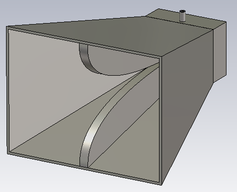

## Reflection Coefficient

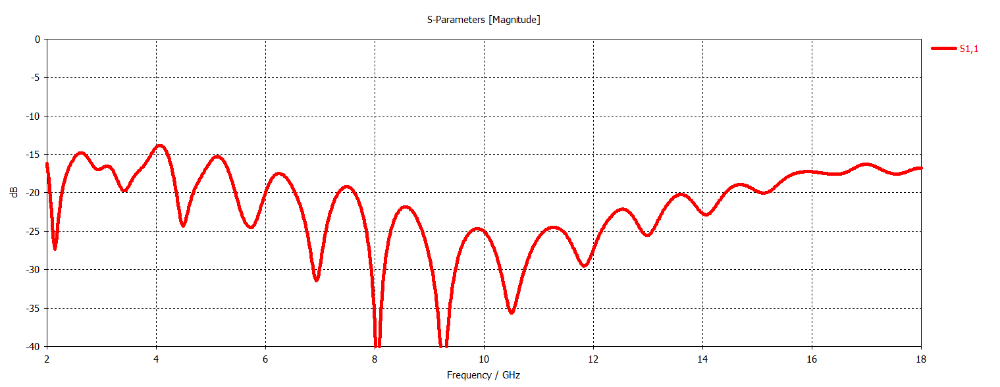

## VSWR

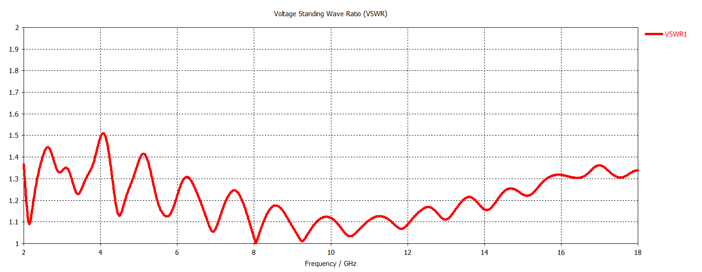

## Realized Gain

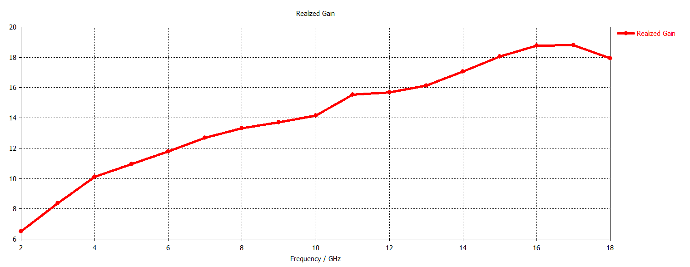

## Radiation Patterns

### 2 GHz

<table>
<tr>
<td align="center">
  
</td>
<td align="center">
  
</td>
</tr>
</table>

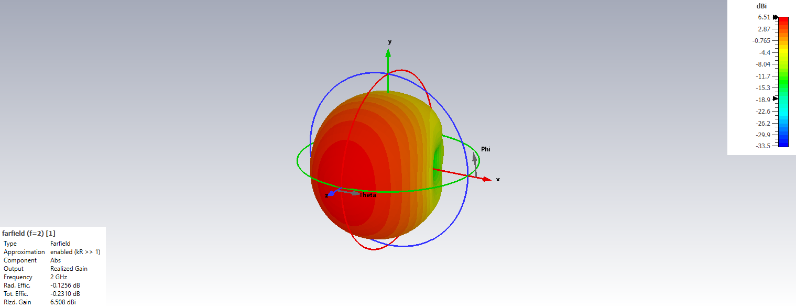

### 4 GHz

<table>
<tr>
<td align="center">
  
</td>
<td align="center">
  
</td>
</tr>
</table>

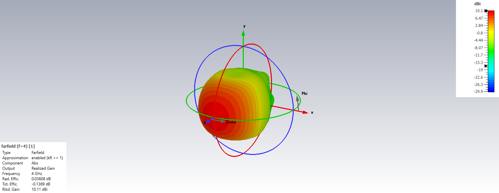

### 6 GHz

<table>
<tr>
<td align="center">
  
</td>
<td align="center">
  
</td>
</tr>
</table>

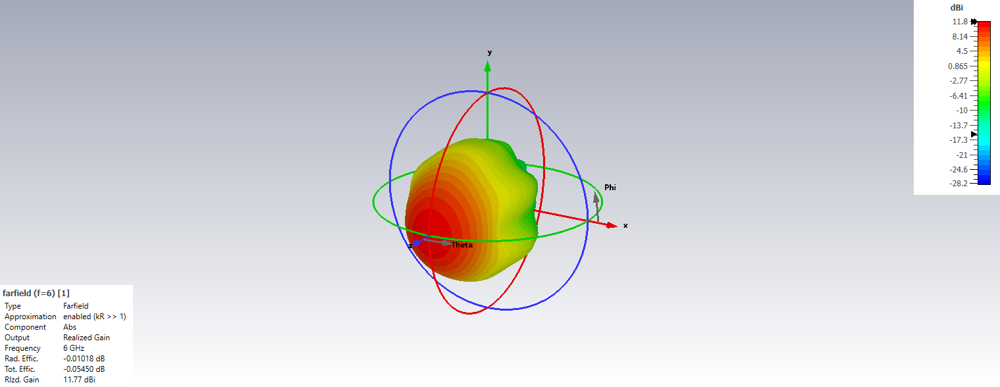

### 8 GHz

<table>
<tr>
<td align="center">
  
</td>
<td align="center">
  
</td>
</tr>
</table>

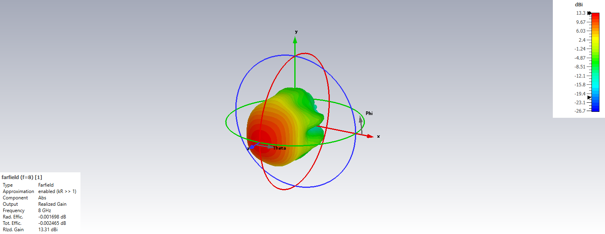

### 10 GHz

<table>
<tr>
<td align="center">
  
</td>
<td align="center">
  
</td>
</tr>
</table>

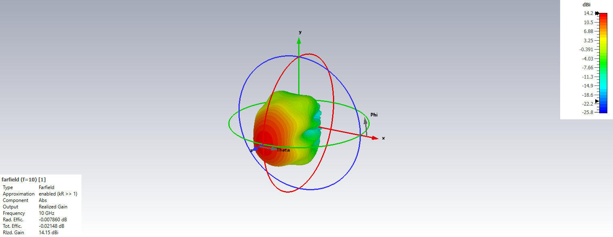

### 12 GHz

<table>
<tr>
<td align="center">
  
</td>
<td align="center">
  
</td>
</tr>
</table>

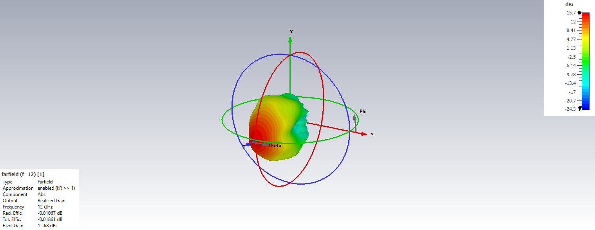

### 14 GHz

<table>
<tr>
<td align="center">
  
</td>
<td align="center">
  
</td>
</tr>
</table>

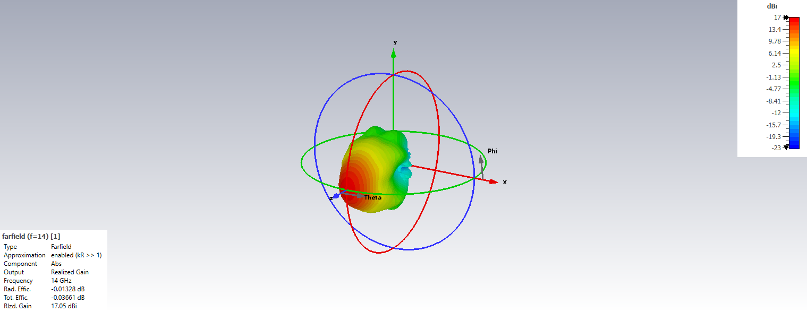

### 16 GHz

<table>
<tr>
<td align="center">
  
</td>
<td align="center">
  
</td>
</tr>
</table>

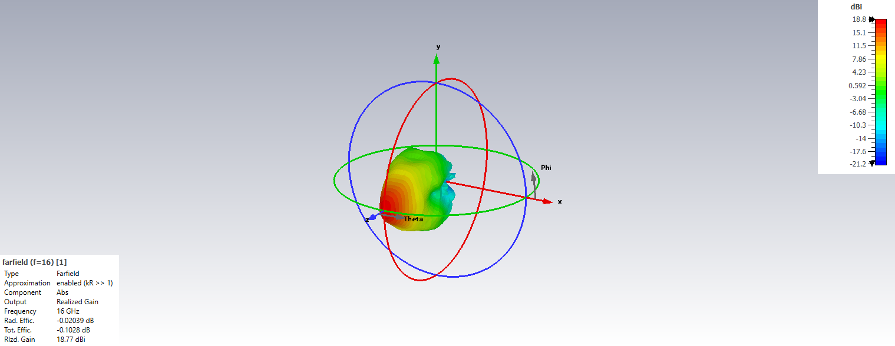

### 18 GHz

<table>
<tr>
<td align="center">
  
</td>
<td align="center">
  
</td>
</tr>
</table>

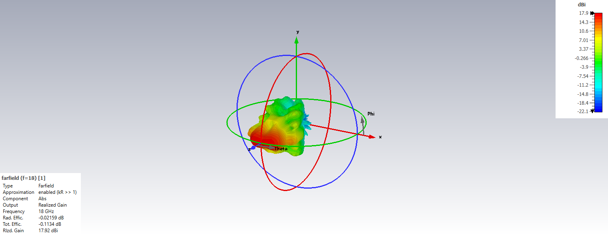
