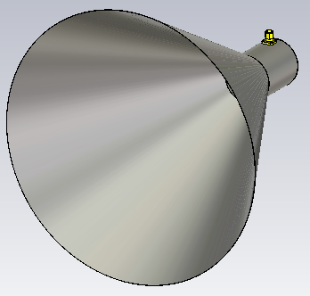
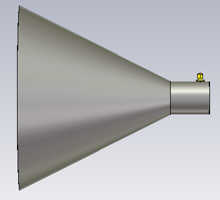
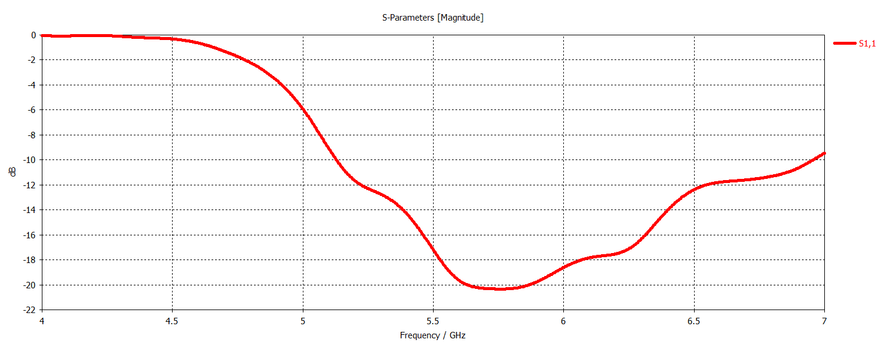
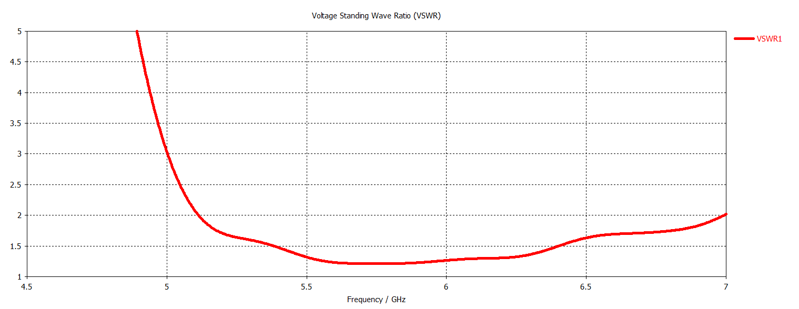
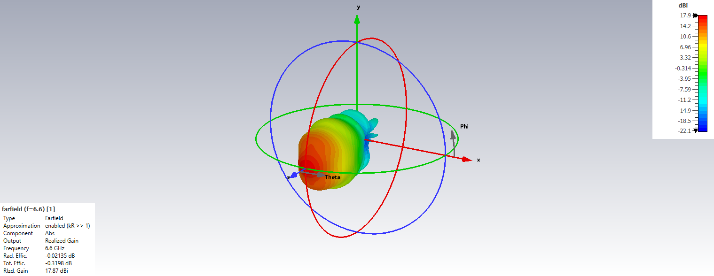

# C-Band Circular Horn Antenna

## Overview

This design presents a C-band circular horn antenna developed and analyzed using CST Studio Suite.

The antenna is designed for linearly polarized, high-gain directional radiation over the C-band. The circular horn geometry provides a smooth transition from the feeding waveguide region to free space, enabling efficient radiation with a narrow main beam and stable gain characteristics across the operating band.

The antenna performance was evaluated using S-parameters, VSWR, realized gain, front-to-back ratio, E-plane and H-plane radiation patterns, and three-dimensional far-field radiation patterns at multiple frequencies across the operating band.

## Key Features

- **Simulation Tool:** CST Studio Suite
- **Antenna Type:** Circular Horn Antenna
- **Operating Band:** C-Band
- **Polarization:** Linear
- **Radiation Characteristic:** Uni-directional
- **Main Performance Parameters:** S-parameters, VSWR, realized gain, front-to-back ratio and radiation patterns
- **Radiation Pattern Evaluation Frequencies:** 4.6, 5.0, 5.4, 5.8, 6.2, 6.6 and 7.0 GHz
- **Analyzed Planes:** E-Plane and H-Plane

## Antenna Geometry

<table>
<tr>
<td align="center">
  
</td>
<td align="center">
  
</td>
</tr>
</table>

## S-Parameters

## VSWR

## Realized Gain

## Front-to-Back Ratio

## Radiation Patterns

### 4.6 GHz

#### E-Plane

#### H-Plane

#### 3D Radiation Pattern

### 5.0 GHz

#### E-Plane

#### H-Plane

#### 3D Radiation Pattern

### 5.4 GHz

#### E-Plane

#### H-Plane

#### 3D Radiation Pattern

### 5.8 GHz

#### E-Plane

#### H-Plane

#### 3D Radiation Pattern

### 6.2 GHz

#### E-Plane

#### H-Plane

#### 3D Radiation Pattern

### 6.6 GHz

#### E-Plane

#### H-Plane

#### 3D Radiation Pattern

### 7.0 GHz

#### E-Plane

#### H-Plane

#### 3D Radiation Pattern

