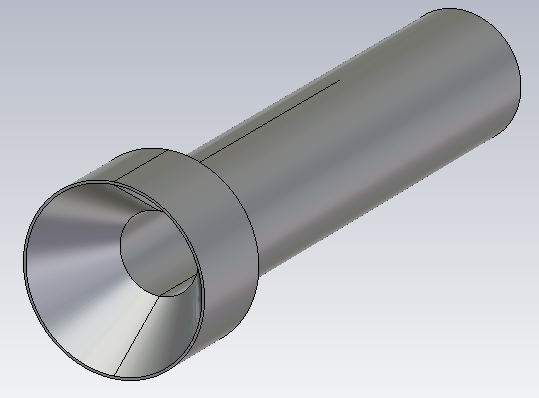
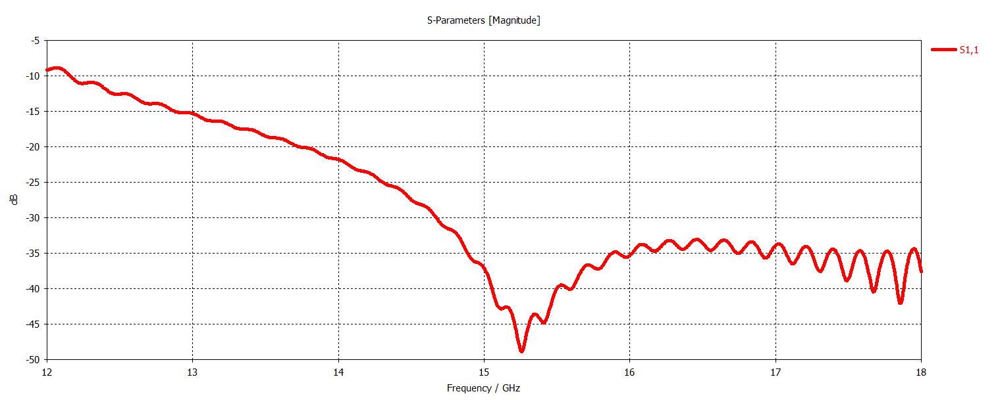
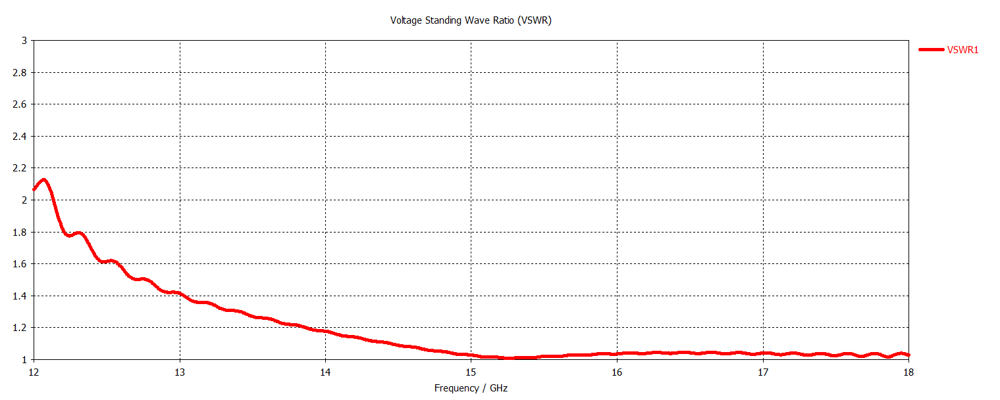
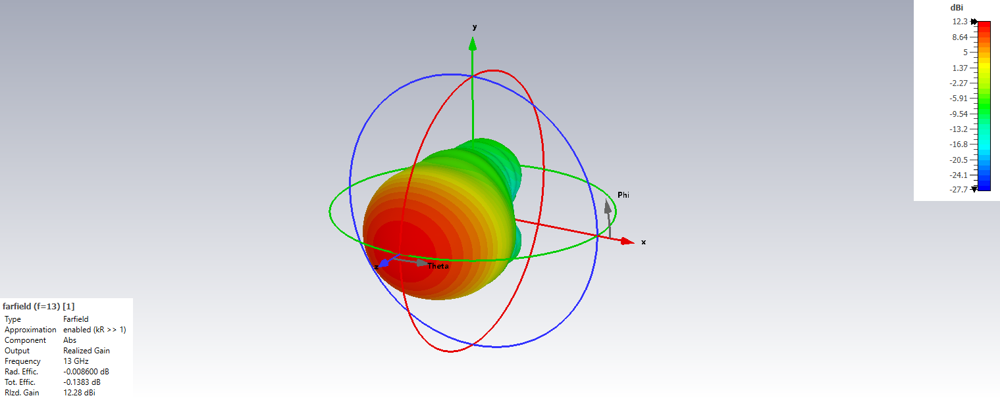
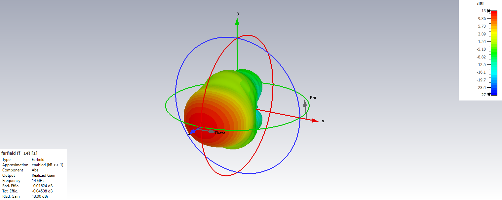
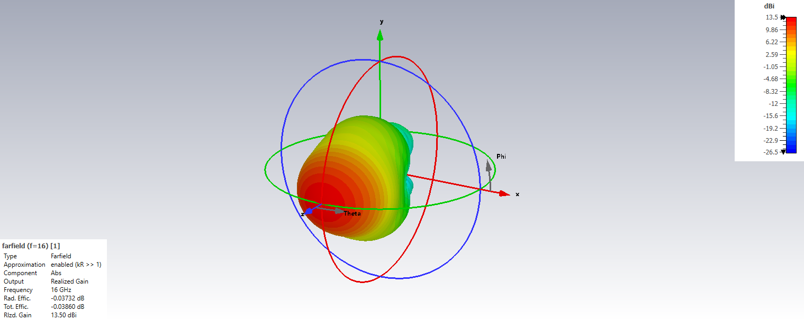
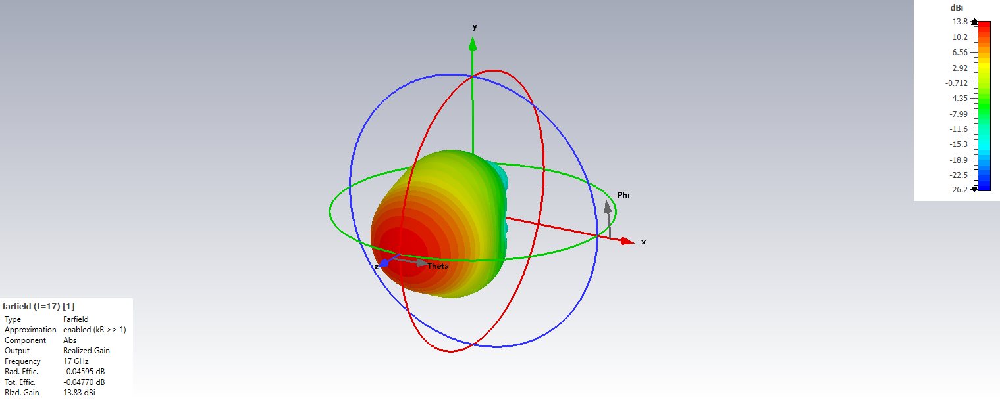
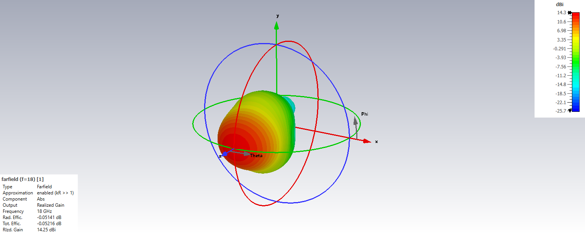

# Ku-Band Circular Horn Antenna

## Overview

This design presents a Ku-band circular horn antenna developed and analyzed using CST Studio Suite.

The antenna was designed as a high-gain, linearly polarized feed antenna for reflector antenna systems. Its circular horn geometry provides a directive radiation pattern with controlled beamwidth, making it suitable for illuminating reflector apertures in microwave and satellite communication applications.

The design performance was evaluated using reflection coefficient, VSWR, E-plane and H-plane radiation patterns, and three-dimensional far-field radiation patterns across the Ku-band operating range.

Particular attention was given to maintaining stable directional radiation characteristics over frequency in order to provide consistent illumination performance when used as a reflector feed.

## Key Features

- **Simulation Tool:** CST Studio Suite
- **Antenna Type:** Circular Horn Antenna
- **Operating Band:** Ku-Band
- **Primary Application:** Reflector Antenna Feed
- **Polarization:** Linear
- **Radiation Characteristic:** Uni-directional
- **Main Performance Parameters:** S11, VSWR and radiation patterns
- **Radiation Pattern Evaluation Frequencies:** 13, 14, 15, 16, 17 and 18 GHz
- **Analyzed Planes:** E-Plane and H-Plane

## Antenna Geometry

## Reflection Coefficient

## VSWR

## Radiation Patterns

### 13 GHz

#### E-Plane

#### H-Plane

#### 3D Radiation Pattern

### 14 GHz

#### E-Plane

#### H-Plane

#### 3D Radiation Pattern

### 15 GHz

#### E-Plane

#### H-Plane

#### 3D Radiation Pattern

### 16 GHz

#### E-Plane

#### H-Plane

#### 3D Radiation Pattern

### 17 GHz

#### E-Plane

#### H-Plane

#### 3D Radiation Pattern

### 18 GHz

#### E-Plane

#### H-Plane

#### 3D Radiation Pattern

