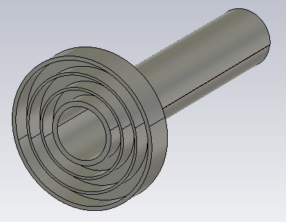
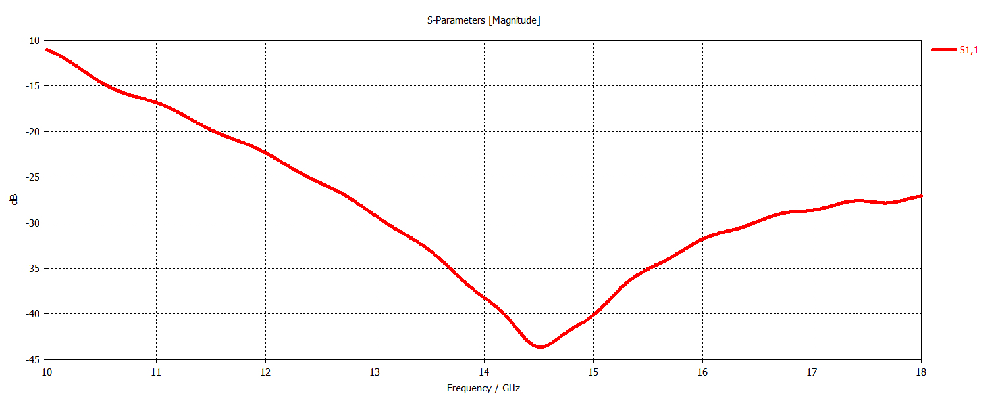
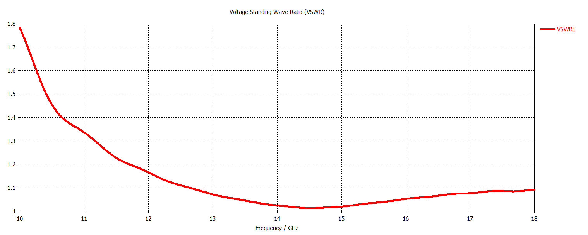
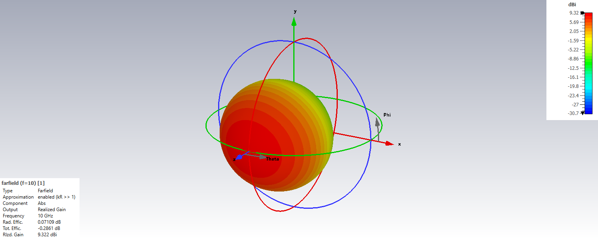
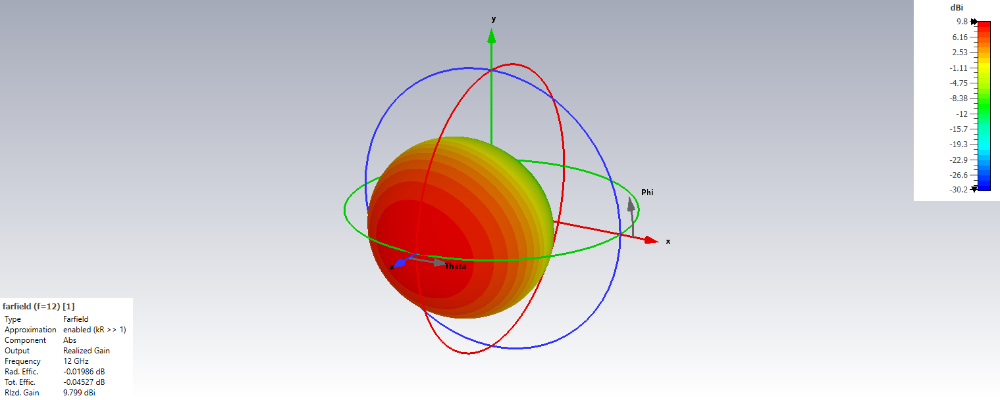
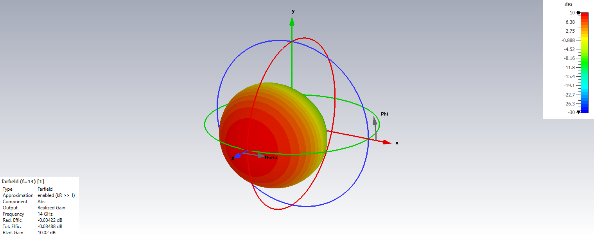
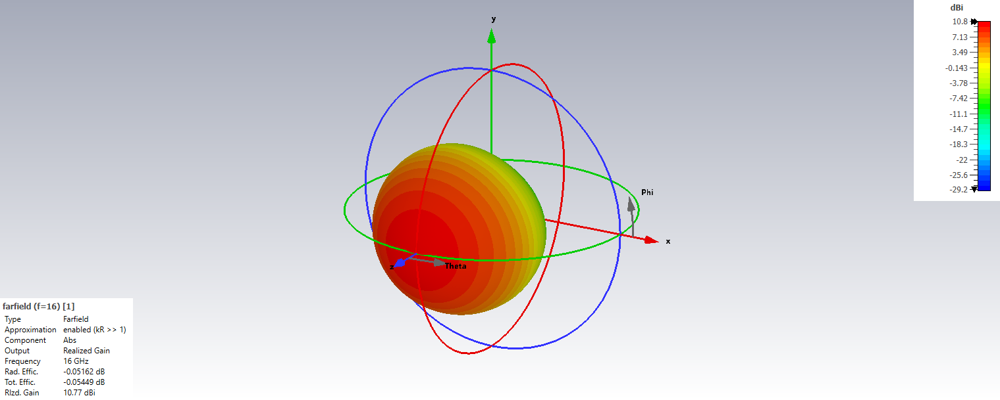
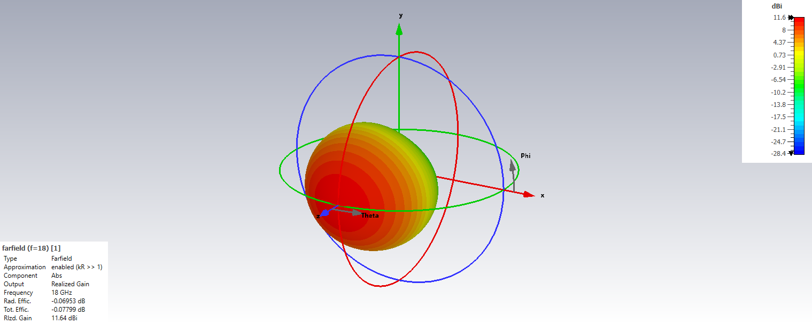

# Ku-Band Corrugated Circular Horn Antenna

## Overview

This design presents a Ku-band corrugated circular horn antenna developed and analyzed using CST Studio Suite.

The antenna was designed as a high-performance feed antenna for reflector antenna systems. The corrugated circular horn structure improves radiation symmetry, enhances pattern quality and supports controlled beam characteristics that are desirable for reflector illumination.

The corrugations help shape the aperture fields and improve the radiation performance of the horn, providing a directive main beam, stable radiation characteristics and reduced unwanted sidelobe behavior across the operating band.

The antenna performance was evaluated using S-parameters, VSWR, realized gain, front-to-back ratio, E-plane and H-plane radiation patterns, and three-dimensional far-field radiation patterns at multiple frequencies across the Ku-band.

## Key Features

- **Simulation Tool:** CST Studio Suite
- **Antenna Type:** Corrugated Circular Horn Antenna
- **Operating Band:** Ku-Band
- **Primary Application:** Reflector Antenna Feed
- **Polarization:** Linear
- **Radiation Characteristic:** Uni-directional
- **Main Performance Parameters:** S-parameters, VSWR, realized gain, front-to-back ratio and radiation patterns
- **Radiation Pattern Evaluation Frequencies:** 10, 12, 14, 16 and 18 GHz
- **Analyzed Planes:** E-Plane and H-Plane

## Antenna Geometry

## S-Parameters

## VSWR

## Realized Gain

## Front-to-Back Ratio

## Radiation Patterns

### 10 GHz

#### E-Plane

#### H-Plane

#### 3D Radiation Pattern

### 12 GHz

#### E-Plane

#### H-Plane

#### 3D Radiation Pattern

### 14 GHz

#### E-Plane

#### H-Plane

#### 3D Radiation Pattern

### 16 GHz

#### E-Plane

#### H-Plane

#### 3D Radiation Pattern

### 18 GHz

#### E-Plane

#### H-Plane

#### 3D Radiation Pattern

