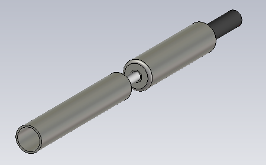
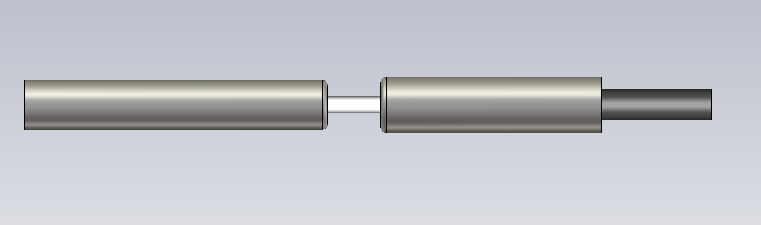
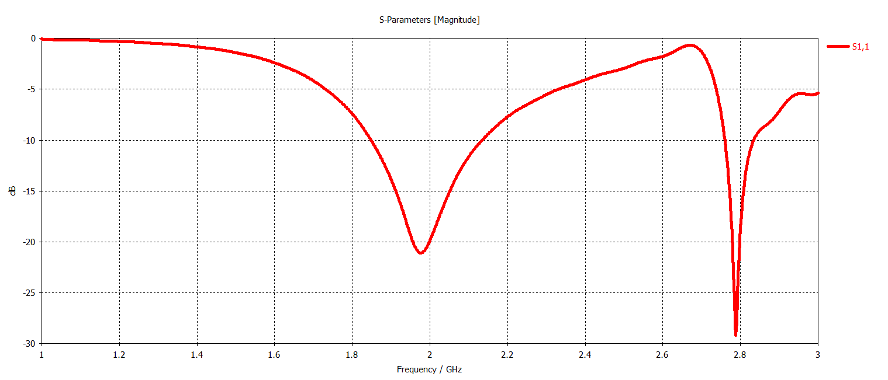
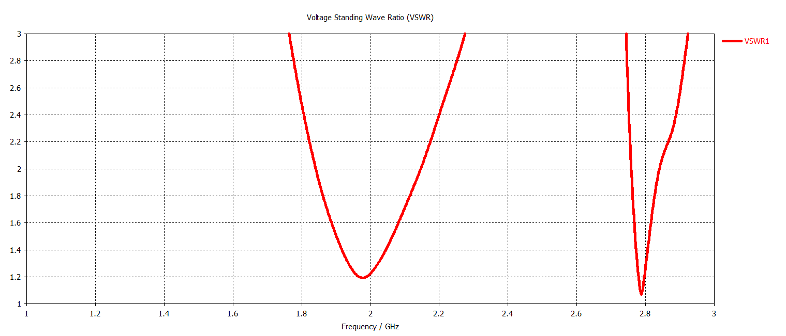
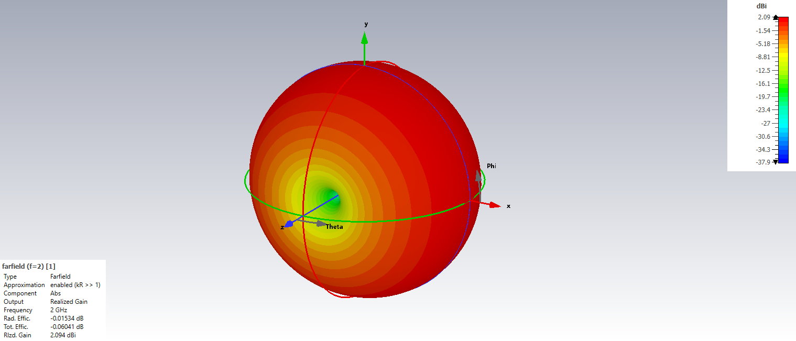
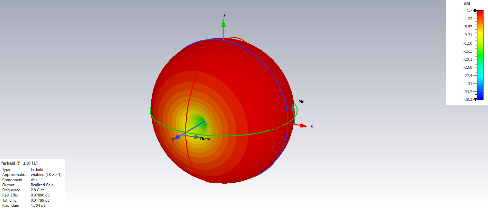

# S-Band Dual-Band Sleeve Antenna

## Overview

This design presents a dual-band sleeve antenna developed and analyzed using CST Studio Suite for S-band operation.

The antenna is designed to operate around two distinct center frequencies, approximately 2.0 GHz and 2.8 GHz. The sleeve-based geometry provides two resonant operating regions while maintaining an omnidirectional-type radiation behavior suitable for compact RF communication applications.

The antenna performance was evaluated using S-parameters, VSWR, azimuth and elevation radiation patterns, and three-dimensional far-field radiation patterns at both operating frequencies.

## Key Features

- **Simulation Tool:** CST Studio Suite
- **Antenna Type:** Sleeve Antenna
- **Operating Band:** S-Band
- **Operation Type:** Dual-Band
- **Center Frequency 1:** 2.0 GHz
- **Center Frequency 2:** 2.8 GHz
- **Polarization:** Linear
- **Radiation Characteristic:** Omni-directional
- **Main Performance Parameters:** S-parameters, VSWR and radiation patterns

## Antenna Geometry

<table>
<tr>
<td align="center">
  
</td>
<td align="center">
  
</td>
</tr>
</table>

## S-Parameters

## VSWR

## Radiation Patterns

### 2.0 GHz

#### Azimuth Pattern

#### Elevation Pattern

#### 3D Radiation Pattern

### 2.8 GHz

#### Azimuth Pattern

#### Elevation Pattern

#### 3D Radiation Pattern

