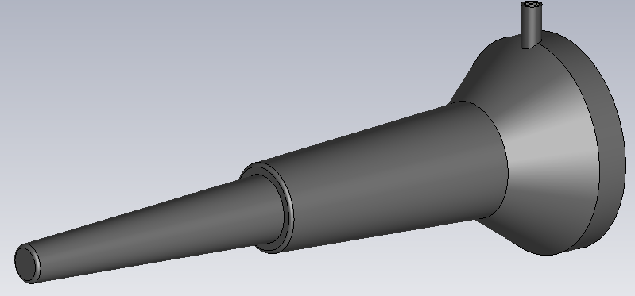
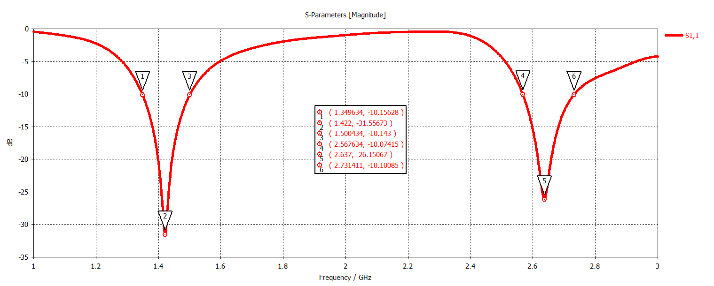
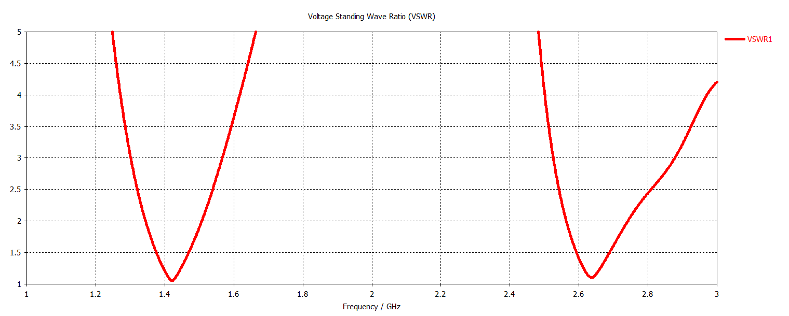
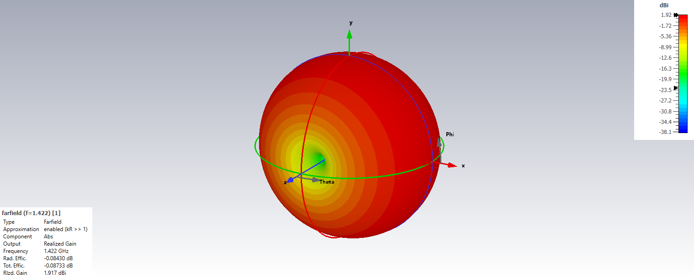
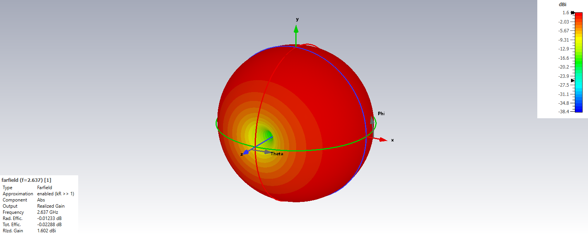

# Dual-Band Sleeve Antenna with Radome

## Overview

This design presents a dual-band sleeve antenna developed and analyzed using CST Studio Suite.

The antenna operates at two distinct resonant frequencies, approximately 1.422 GHz and 2.637 GHz. The sleeve-based structure provides dual-band operation together with an omnidirectional radiation characteristic suitable for compact communication applications.

In addition to the antenna design, a protective radome structure was also modeled and included in the electromagnetic analysis. The radome material was selected as ABS in order to represent a practical dielectric enclosure around the antenna.

The effect of the complete antenna configuration, including the ABS radome, was evaluated using S-parameters, VSWR, azimuth and elevation radiation patterns, and three-dimensional far-field radiation patterns at both operating frequencies.

## Key Features

- **Simulation Tool:** CST Studio Suite
- **Antenna Type:** Sleeve Antenna
- **Operation Type:** Dual-Band
- **Center Frequency 1:** 1.422 GHz
- **Center Frequency 2:** 2.637 GHz
- **Polarization:** Linear
- **Radiation Characteristic:** Omnidirectional
- **Radome Material:** ABS
- **Main Performance Parameters:** S-parameters, VSWR and radiation patterns
- **Analyzed Planes:** Azimuth and Elevation

## Antenna Geometry

## S-Parameters

## VSWR

## Radiation Patterns

### 1.422 GHz

#### Azimuth Pattern

#### Elevation Pattern

#### 3D Radiation Pattern

### 2.637 GHz

#### Azimuth Pattern

#### Elevation Pattern

#### 3D Radiation Pattern

