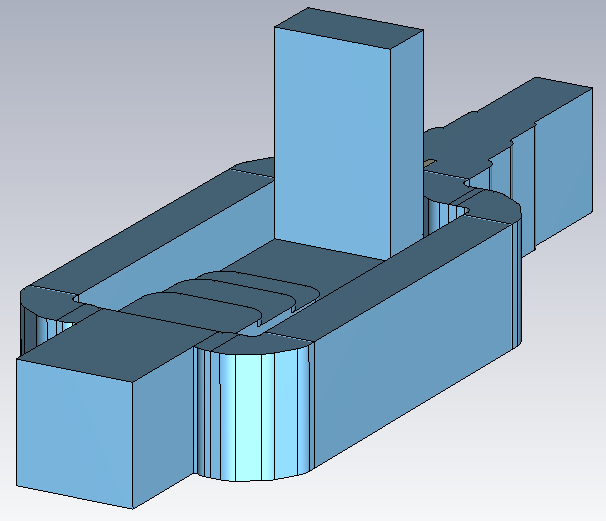
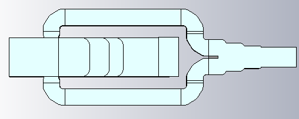

# Ka-Band Boifot Orthomode Transducer (OMT)

## Overview

This design presents a Ka-band Boifot Orthomode Transducer (OMT) developed and analyzed using CST Studio Suite.

The OMT is designed to separate and combine two orthogonally polarized electromagnetic modes through dedicated waveguide ports. The structure includes an axial port and lateral arm ports, while the common port carries the combined orthogonal polarization components.

The axial and lateral arm ports are based on WR28 rectangular waveguide interfaces. The electromagnetic performance was evaluated in terms of return loss, insertion loss and isolation between the orthogonal signal paths.

## Key Features

- **Simulation Tool:** CST Studio Suite
- **Component Type:** Orthomode Transducer (OMT)
- **OMT Type:** Boifot OMT
- **Operating Band:** Ka-Band
- **Axial Port Standard:** WR28
- **Lateral Arm Port Standard:** WR28
- **Polarization Handling:** Two Orthogonal Linear Polarizations
- **Main Performance Parameters:** Return loss, insertion loss and isolation

## OMT Geometry

<table>
<tr>
<td align="center">
  
</td>
<td align="center">
  
</td>
</tr>
</table>

## Axial Port Return Loss

## Common Port Return Loss

## Insertion Loss – Axial Port to Common Port

## Insertion Loss – Lateral Arms Port to Common Port

## Isolation – Axial Port and Lateral Arms Port

## Lateral Arms Port Return Loss

