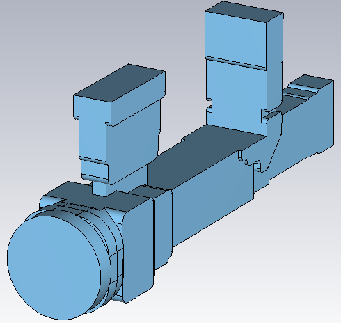
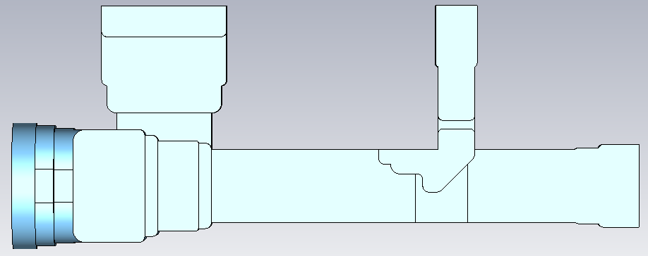
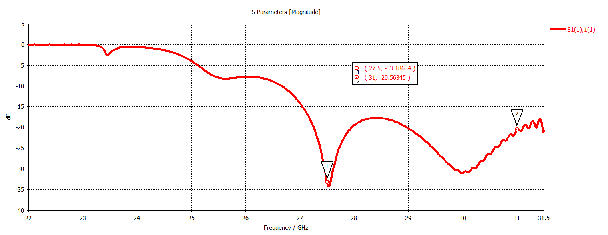
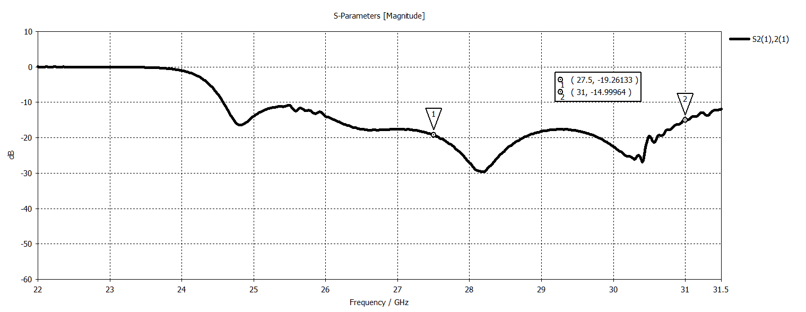
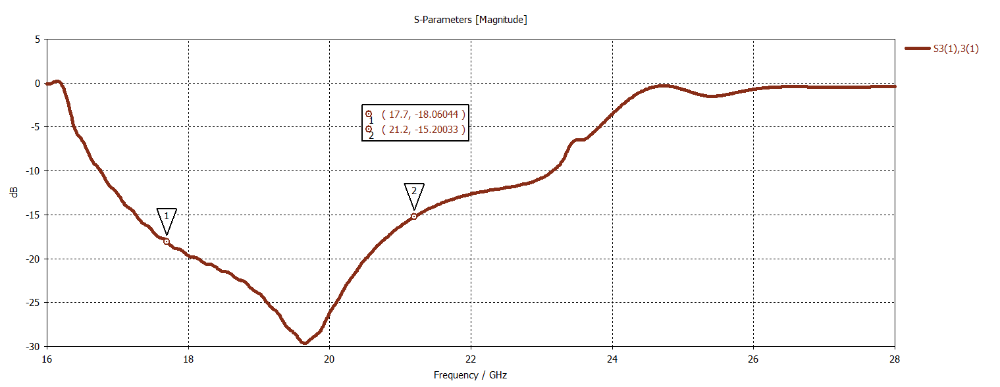
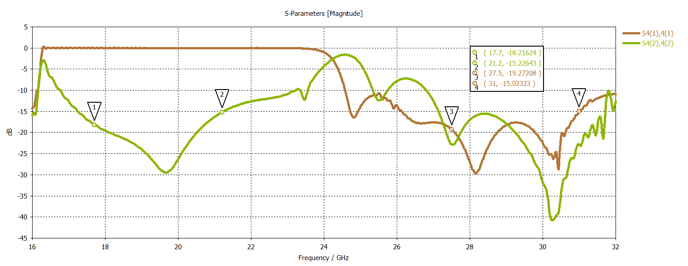
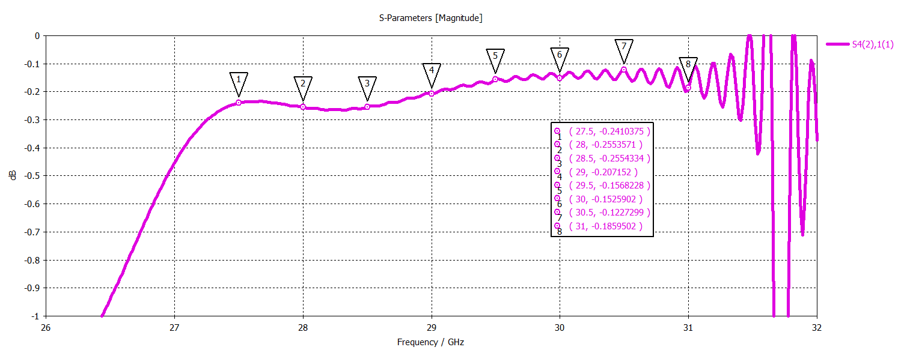
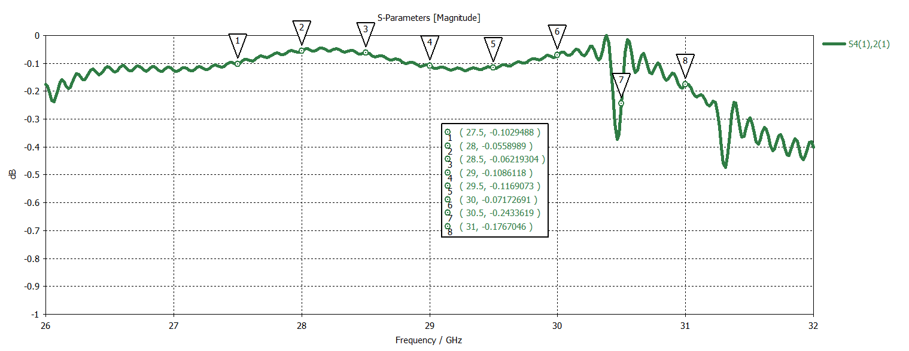

# K/Ka-Band SATCOM Orthomode Transducer (OMT)

## Overview

This design presents a multi-port Orthomode Transducer (OMT) developed and analyzed using CST Studio Suite for satellite communication applications.

The OMT consists of one common port, two transmit (TX) ports and one receive (RX) port. The transmit channels operate over the Ka-band frequency range from 27.5 GHz to 31 GHz, while the receive channel operates over the K-band frequency range from 17.7 GHz to 21.2 GHz.

The two TX ports are implemented using WR28 rectangular waveguide interfaces, while the RX port uses a WR42 rectangular waveguide interface. The common port combines the orthogonal polarization components and provides the shared RF interface of the structure.

## Key Features

- **Simulation Tool:** CST Studio Suite
- **Component Type:** Orthomode Transducer (OMT)
- **Application:** SATCOM
- **Number of Ports:** 4
- **TX Ports:** 2
- **RX Ports:** 1
- **TX Frequency Range:** 27.5–31 GHz
- **RX Frequency Range:** 17.7–21.2 GHz
- **TX Port Standard:** WR28
- **RX Port Standard:** WR42

## OMT Geometry

<table>
<tr>
<td align="center">
  
</td>
<td align="center">
  
</td>
</tr>
</table>

## Return Loss

### Ka-Band Horizontal Port Return Loss

### Ka-Band Vertical Port Return Loss

### K-Band Horizontal Port Return Loss

### Common Port Return Loss

## Insertion Loss

### Ka-Band Horizontal Port to Common Port

### Ka-Band Vertical Port to Common Port

## Isolation

### Isolation Between K-Band Horizontal and Ka-Band Vertical Ports

### Isolation Between Ka-Band Vertical and Ka-Band Horizontal Ports

