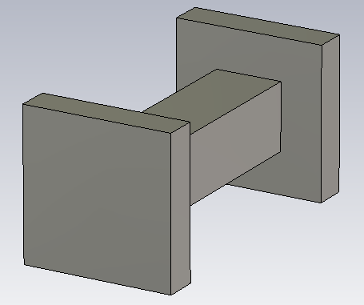
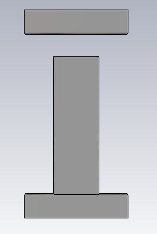

# Groove Gap Waveguide Periodic Pin Unit Cell

## Overview

This design presents a periodic pin unit-cell structure developed and analyzed using CST Studio Suite for groove gap waveguide applications.

The periodic metallic pin structure is designed to create an electromagnetic bandgap (EBG) region in which parallel-plate modes are suppressed.

Eigenmode analysis was performed using periodic boundary conditions, and the resulting dispersion diagram indicates an approximate electromagnetic bandgap between 10 GHz and 19.5 GHz.

## Key Features

- **Simulation Tool:** CST Studio Suite
- **Structure Type:** Periodic Metallic Pin Unit Cell
- **Application:** Groove Gap Waveguide
- **Analysis Method:** Eigenmode / Dispersion Analysis
- **Approximate EBG Region:** 10–19.5 GHz
- **Displayed Eigenmodes:** First 10 modes

## Unit Cell Geometry

<table>
<tr>
<td align="center">
  
</td>
<td align="center">
  
</td>
</tr>
</table>

## Dispersion Diagram

