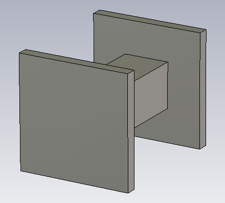
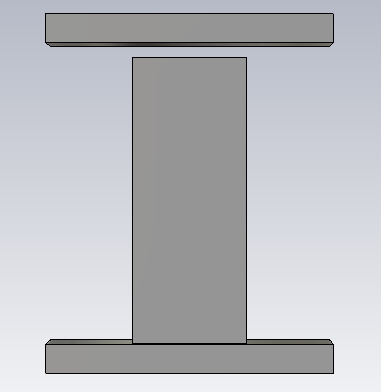

# Groove Gap Waveguide Periodic Pin Unit Cell

## Overview

This design presents a periodic metallic pin unit-cell structure developed and analyzed using CST Studio Suite for groove gap waveguide applications.

The periodic structure is designed to create an electromagnetic bandgap (EBG) region in which unwanted parallel-plate propagation is suppressed.

Eigenmode analysis was performed using periodic boundary conditions. The resulting dispersion characteristics indicate a wide electromagnetic bandgap extending approximately from 20 GHz to 69 GHz.

This wide stopband makes the periodic pin structure suitable for high-frequency groove gap waveguide implementations where electromagnetic confinement is required without direct electrical contact between the metallic surfaces.

## Key Features

- **Simulation Tool:** CST Studio Suite
- **Structure Type:** Periodic Metallic Pin Unit Cell
- **Application:** Groove Gap Waveguide
- **Analysis Method:** Eigenmode / Dispersion Analysis
- **Approximate Electromagnetic Bandgap:** 20–69 GHz
- **Displayed Eigenmodes:** First 10 modes
- **Frequency Region:** Millimeter-wave / high microwave frequencies

## Unit Cell Geometry

<table>
<tr>
<td align="center">
  
</td>
<td align="center">
  
</td>
</tr>
</table>

## Dispersion Diagram

## Electromagnetic Bandgap Region

The dispersion analysis shows an approximate electromagnetic bandgap between **20 GHz and 69 GHz**, where no propagating eigenmodes are observed in the calculated modal spectrum.

This bandgap represents the operating region in which the periodic pin structure behaves as an electromagnetic stopband surface and can be used to confine propagation within a groove gap waveguide structure.
