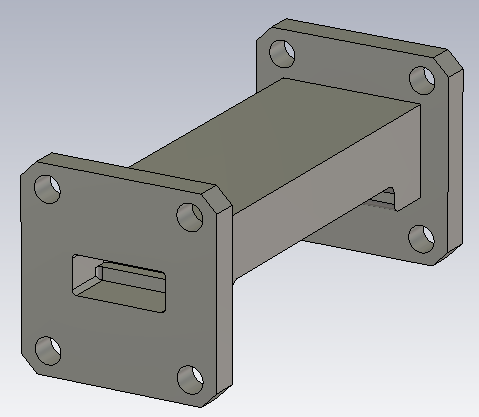
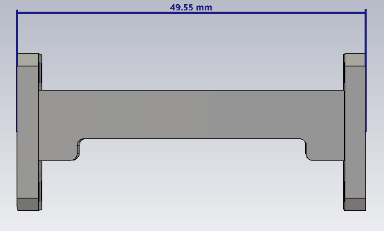
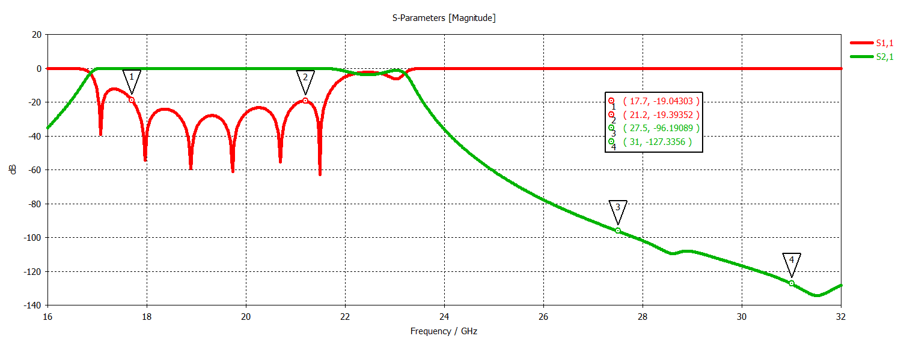

# K–Ka Band Low-Pass Waveguide Filter

## Overview

This design presents a K–Ka band low-pass waveguide filter developed and analyzed using CST Studio Suite for satellite communication applications.

The filter is implemented using WR42 rectangular waveguide ports and is designed to provide low-loss transmission throughout the receive (RX) band while strongly suppressing the transmit (TX) band.

The target RX passband is 17.7–21.2 GHz, while the target TX rejection band is 27.5–31 GHz. The design therefore acts as a low-pass waveguide filter that separates the lower-frequency K-band receive region from the higher-frequency Ka-band transmit region.

## Key Features

- **Simulation Tool:** CST Studio Suite
- **Component Type:** Low-Pass Waveguide Filter
- **Waveguide Standard:** WR42
- **Application:** K–Ka Band SATCOM
- **RX Passband:** K-Band / 17.7–21.2 GHz
- **TX Rejection Band:** Ka Band / 27.5–31 GHz
- **Main Performance Parameters:** S11 and S21

## Filter Geometry

<table>
<tr>
<td align="center">
  
</td>
<td align="center">
  
</td>
</tr>
</table>

## S-Parameters

