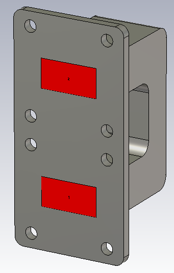
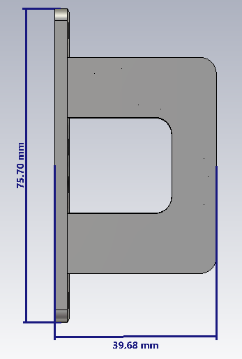
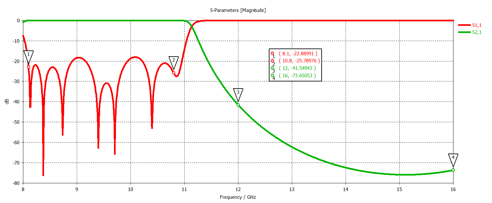

# X–Ku Band Low-Pass Waveguide Filter

## Overview

This design presents an X–Ku band low-pass waveguide filter developed and analyzed using CST Studio Suite.

The filter is designed to provide low-loss transmission throughout the X-band region while suppressing higher-frequency signals extending into the Ku-band. The simulated response exhibits a sharp transition between the passband and stopband together with high out-of-band rejection.

This type of waveguide filter can be used in satellite communication, radar and microwave front-end systems to suppress unwanted higher-frequency components and improve isolation between adjacent RF channels.

## Key Features

- **Simulation Tool:** CST Studio Suite
- **Component Type:** Low-Pass Waveguide Filter
- **Operating Region:** X–Ku Band
-  **Waveguide Standard:** WR75
- **Approximate Passband:** 8.1–10.8 GHz
- **Approximate Stopband:** 12–16 GHz
- **Main Performance Parameters:** S11 and S21
- **Potential Applications:** SATCOM, radar and microwave front-end filtering

## Filter Geometry

<table>
<tr>
<td align="center">
  
</td>
<td align="center">
  
</td>
</tr>
</table>

## S-Parameters

