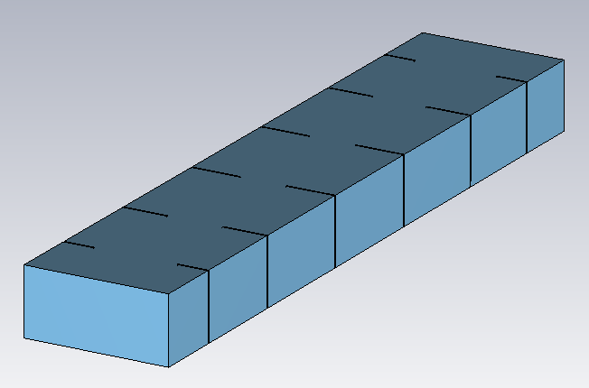
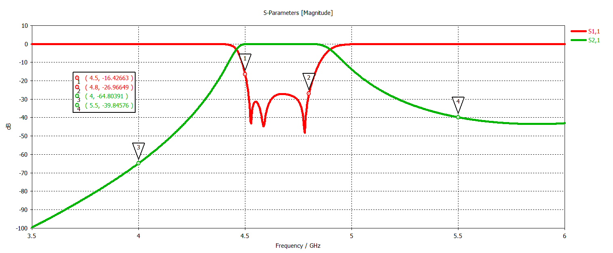

# C-Band Iris Waveguide Band-Pass Filter

## Overview

This design presents a C-band band-pass waveguide filter developed and analyzed using CST Studio Suite.

The filter is implemented using a WR187 rectangular waveguide structure and employs a series of iris discontinuities to realize the desired band-pass response.

The iris sections introduce controlled reactive discontinuities inside the waveguide, forming the resonant filtering structure. The simulated response shows strong transmission within the passband while suppressing frequencies below and above the intended operating region.

## Key Features

- **Simulation Tool:** CST Studio Suite
- **Component Type:** Waveguide Band-Pass Filter
- **Waveguide Standard:** WR187
- **Operating Band:** C-Band
- **Filter Topology:** Iris-Coupled Waveguide Filter
- **Approximate Passband:** 4.5–4.8 GHz
- **Main Performance Parameters:** S11 and S21

## Filter Geometry

## S-Parameters

