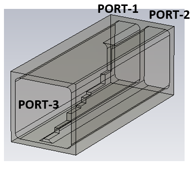
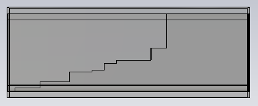
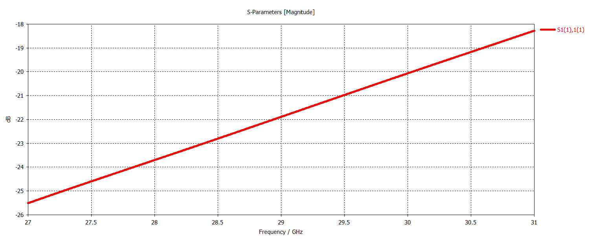
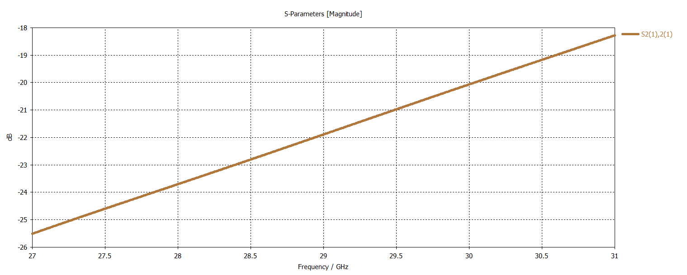
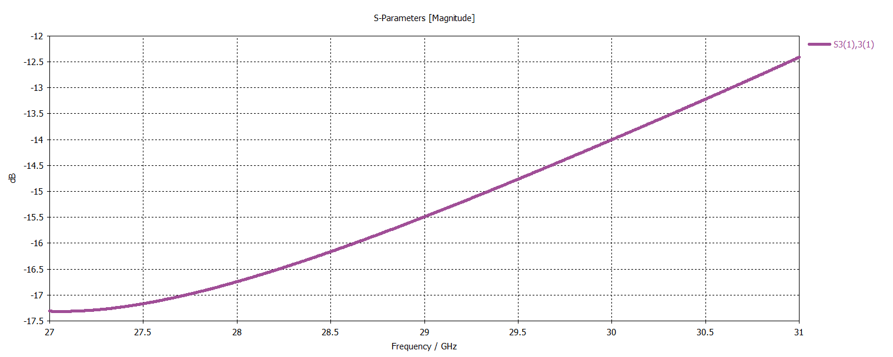
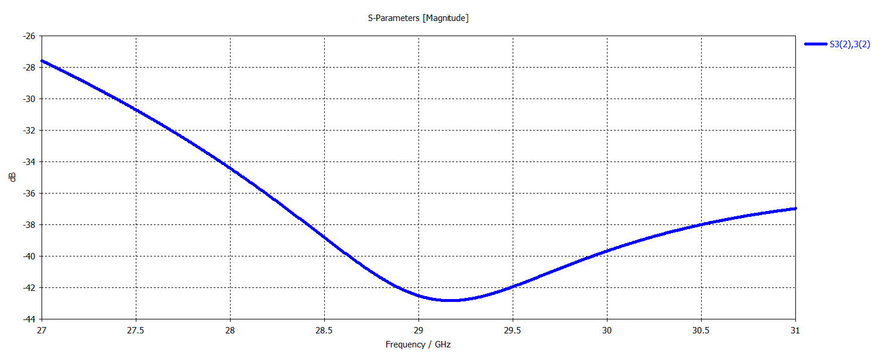
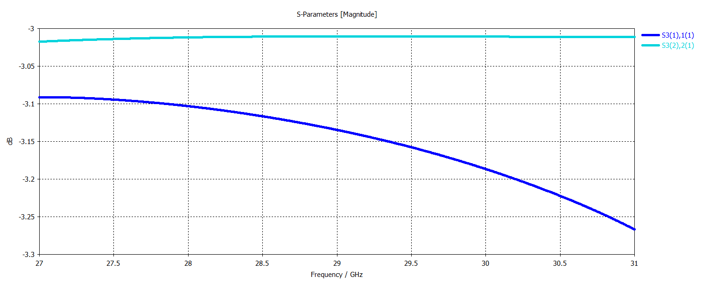
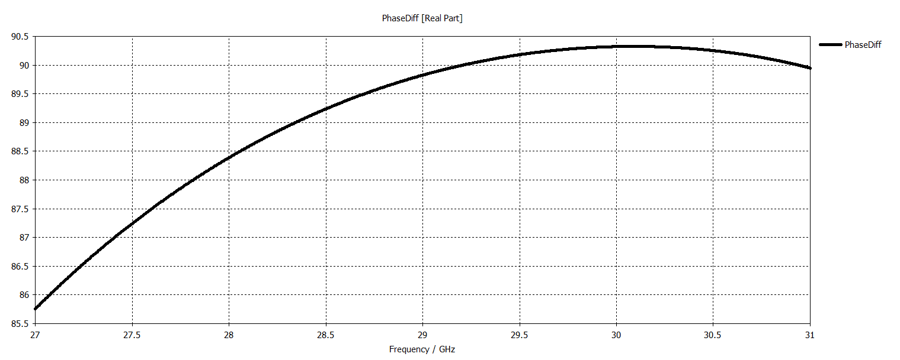
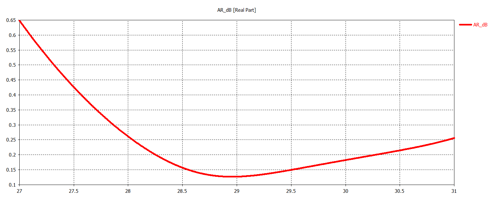

# Ka-Band Waveguide Septum Polarizer

## Overview

This design presents a Ka-band waveguide septum polarizer developed and analyzed using CST Studio Suite.

The structure is based on a waveguide septum configuration and is intended to support polarization conversion and control in the Ka-band. Port 1 and Port 2 correspond to two orthogonal linear polarizations, while Port 3 is the common port.

The polarizer performance was evaluated in terms of return loss, insertion loss, isolation between the orthogonal linear ports, phase difference between orthogonal polarization components and axial ratio performance.

## Key Features

- **Simulation Tool:** CST Studio Suite
- **Component Type:** Waveguide Septum Polarizer
- **Operating Band:** Ka-Band
- **Port 1:** Linear Polarization 1
- **Port 2:** Linear Polarization 2
- **Port 3:** Common Port
- **Main Performance Parameters:** Return loss, insertion loss, isolation, phase difference and axial ratio

## Septum Polarizer Geometry

<table>
<tr>
<td align="center">
  
</td>
<td align="center">
  
</td>
</tr>
</table>

## Return Loss

### Port 1 Return Loss

### Port 2 Return Loss

### Port 3 Return Loss for Polarization 1

### Port 3 Return Loss for Polarization 2

## Isolation

### Isolation Between Port 1 and Port 2

## Insertion Loss

### Transmission Coefficients – Common Port to Orthogonal Ports

## Phase Difference

### Phase Difference Between Orthogonal Polarizations

## Axial Ratio

### Axial Ratio (dB)

