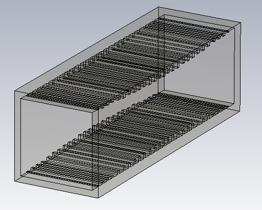
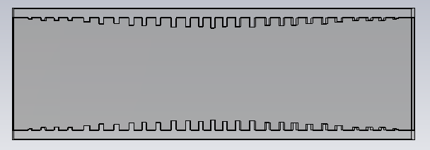
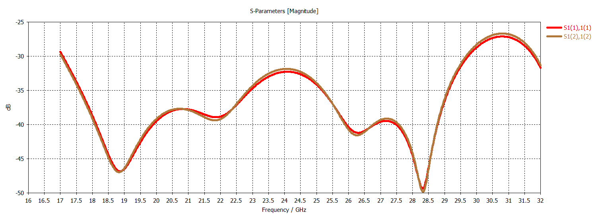
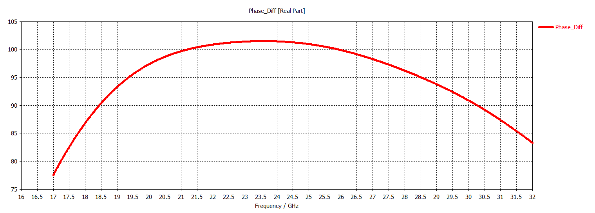
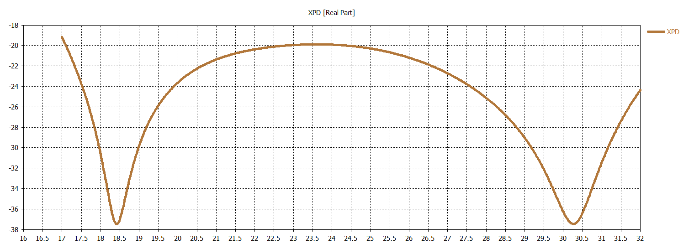
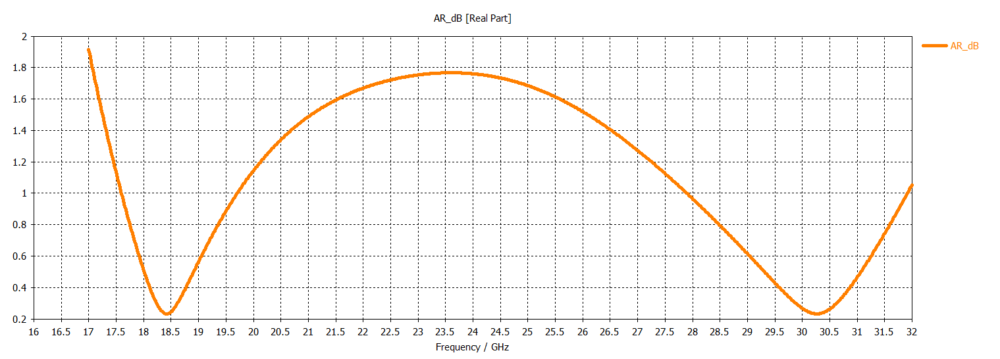

# K/Ka Band Waveguide Iris Polarizer

## Overview

This design presents a waveguide iris polarizer developed and analyzed using CST Studio Suite.

The structure uses a series of iris discontinuities inside the waveguide to control the relative amplitude and phase of two orthogonal electromagnetic field components.

Port 1 supports two orthogonal linear modes. When these modes are excited, the iris structure introduces the required phase relationship between the orthogonal field components and produces circular polarization inside the polarizer.

Port 2 is used to evaluate the resulting polarization state through two orthogonal modes.

The polarizer performance was evaluated using input return loss, mode coupling, output polarization decomposition, differential phase, cross-polar discrimination (XPD) and axial ratio.

## Key Features

- **Simulation Tool:** CST Studio Suite
- **Component Type:** Waveguide Iris Polarizer
- **Polarization Conversion:** Linear-to-Circular / Circular-to-Linear
- **Polarizing Structure:** Waveguide Iris Discontinuities
- **Main Performance Parameters:** Return loss, mode coupling, transmission, phase difference, XPD and axial ratio
- **Target Differential Phase:** Approximately 90°
- **Target Axial Ratio:** Below 3 dB within the circular-polarization operating region

## Polarizer Geometry

<table>
<tr>
<td align="center">
  
</td>
<td align="center">
  
</td>
</tr>
</table>

## Return Loss

## Mode Coupling at Input Port

## Output Transmission and Polarization Decomposition

## Differential Phase Between Orthogonal Components

## Cross-Polar Discrimination (XPD)

## Axial Ratio

