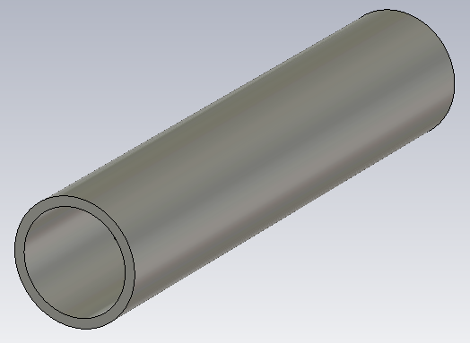
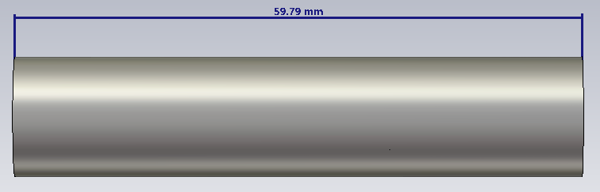
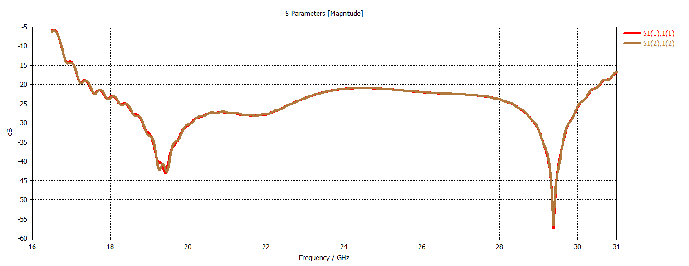

# K/Ka-Band Waveguide Polarizer

## Overview

This design presents a broadband K/Ka-band waveguide polarizer developed and analyzed using CST Studio Suite for satellite communication applications.

The polarizer is designed to operate over a wide frequency range extending from 17.7 GHz to 31 GHz, covering both K-band receive and Ka-band transmit regions commonly used in SATCOM systems.

The structure controls the relative amplitude and phase of two orthogonal electromagnetic field components in order to achieve the desired polarization transformation across a broad operating bandwidth.

A key feature of the design is its broadband polarization purity. The simulated response demonstrates strong cross-polar discrimination across the 17.7–31 GHz operating range, with cross-polarization levels suppressed by approximately 30 dB or better over a substantial portion of the band.

The electromagnetic performance was evaluated using return loss, mode coupling, output polarization decomposition, differential phase, cross-polar discrimination (XPD) and axial ratio.

## Key Features

- **Simulation Tool:** CST Studio Suite
- **Component Type:** Broadband Waveguide Polarizer
- **Application:** K/Ka-Band SATCOM
- **Operating Frequency Range:** 17.7–31 GHz
- **RX Frequency Range:** 17.7–21.2 GHz
- **TX Frequency Range:** 27.5–31 GHz
- **Polarization Performance:** Broadband Circular Polarization
- **Cross-Polarization Performance:** Approximately 30 dB suppression or better across much of the operating band
- **Main Performance Parameters:** Return loss, mode coupling, output transmission, differential phase, XPD and axial ratio
- **Target Differential Phase:** Approximately 90°
- **Target Axial Ratio:** Below 3 dB within the circular-polarization operating region

## Polarizer Geometry

<table>
<tr>
<td align="center">
  
</td>
<td align="center">
  
</td>
</tr>
</table>

## Return Loss

## Mode Coupling at Input Port

## Output Transmission and Polarization Decomposition

## Differential Phase Between Orthogonal Components

## Cross-Polar Discrimination (XPD)

## Axial Ratio

