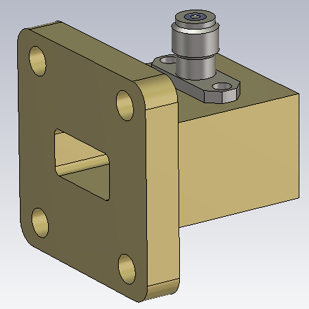
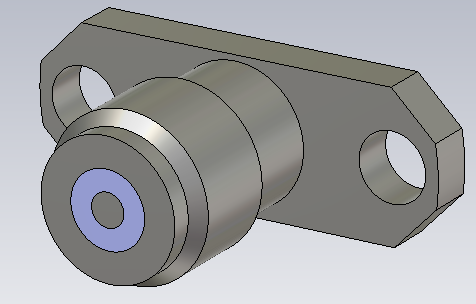
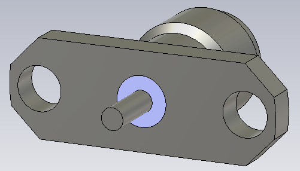
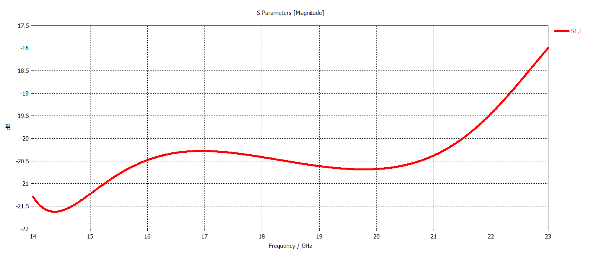
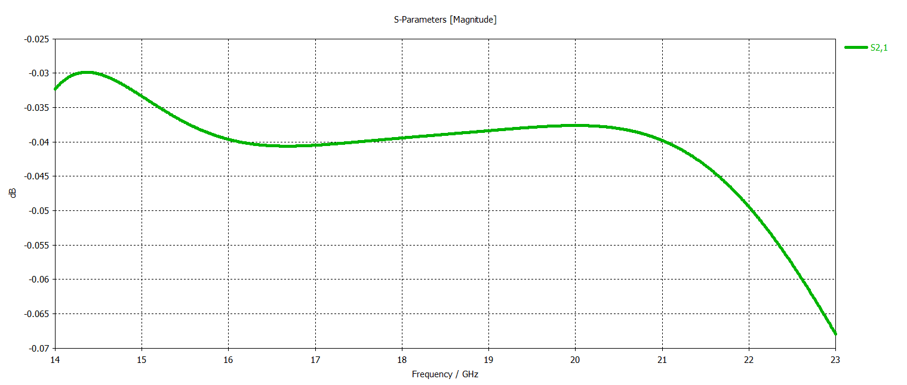

# WR51 Waveguide-to-Coax Adapter

## Overview

This design presents a WR51 waveguide-to-coax adapter developed and analyzed using CST Studio Suite.

The adapter provides a transition between a standard WR51 rectangular waveguide and a coaxial interface. A coaxial probe introduced through a 2.92 mm connector couples electromagnetic energy between the coaxial TEM mode and the dominant TE10 mode of the rectangular waveguide.

The design uses a right-angle coaxial-to-waveguide transition together with a high-frequency 2.92 mm coaxial connector. The electromagnetic performance was evaluated in terms of reflection coefficient, transmission coefficient and VSWR.

## Key Features

- **Simulation Tool:** CST Studio Suite
- **Component Type:** Waveguide-to-Coax Adapter
- **Waveguide Standard:** WR51
- **Dominant Waveguide Mode:** TE10
- **Coaxial Interface:** 2.92 mm
- **Connector Type:** 2 Hole Flange 2.92 mm Connector
- **Transition Type:** Right Angle
- **Main Performance Parameters:** S11, S21 and VSWR

## Materials

- **Waveguide Structure:** Metallic conducting structure
- **Connector Structure:** 2.92 mm coaxial connector
- **Internal Region:** Air / vacuum
- **Simulation Environment:** CST Studio Suite

## WR51 Waveguide Geometry

## 2.92 mm Connector Geometry

<table>
<tr>
<td align="center">
  
</td>
<td align="center">
  
</td>
</tr>
</table>

## Reflection Coefficient

## Transmission Coefficient

## VSWR

