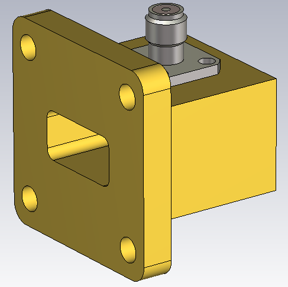
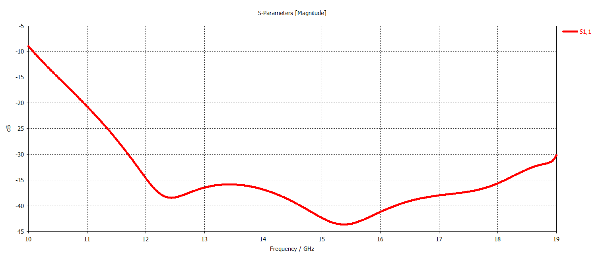
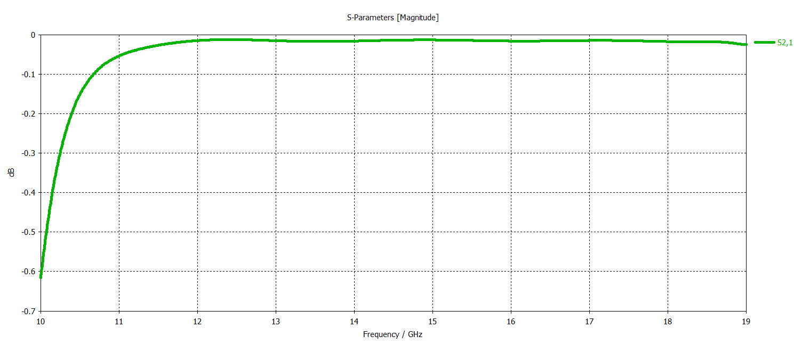
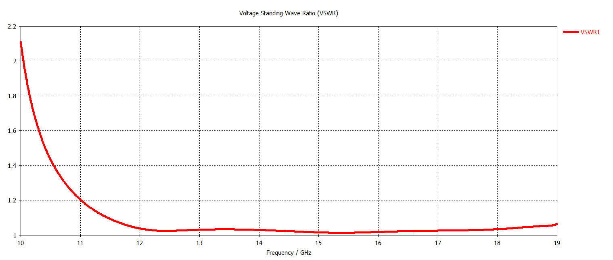

# WR62 Waveguide-to-Coax Adapter

## Overview

This design presents a WR62 waveguide-to-coax adapter developed and analyzed using CST Studio Suite.

The adapter provides a transition between a standard WR62 rectangular waveguide and a coaxial interface. A coaxial probe introduced through an SMA connector couples electromagnetic energy between the coaxial TEM mode and the dominant TE10 mode of the rectangular waveguide.

The design uses a right-angle coaxial-to-waveguide transition together with a flange-mounted SMA connector. The electromagnetic performance was evaluated in terms of reflection coefficient, transmission coefficient and VSWR.

## Key Features

- **Simulation Tool:** CST Studio Suite
- **Component Type:** Waveguide-to-Coax Adapter
- **Waveguide Standard:** WR62
- **Dominant Waveguide Mode:** TE10
- **Coaxial Interface:** SMA
- **Connector Type:** 4-Hole Flange SMA Connector
- **Transition Type:** Right Angle
- **Main Performance Parameters:** S11, S21 and VSWR

## WR62 Waveguide Geometry

## SMA Connector Geometry

<table>
<tr>
<td align="center">
  
</td>
<td align="center">
  
</td>
</tr>
</table>

## Reflection Coefficient

## Transmission Coefficient

## VSWR

