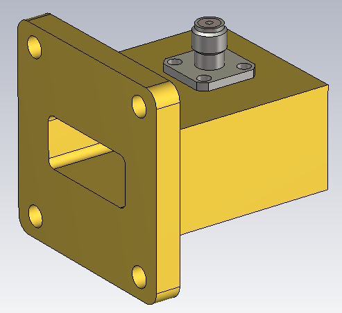
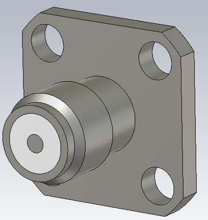
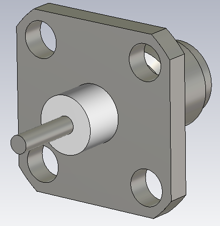
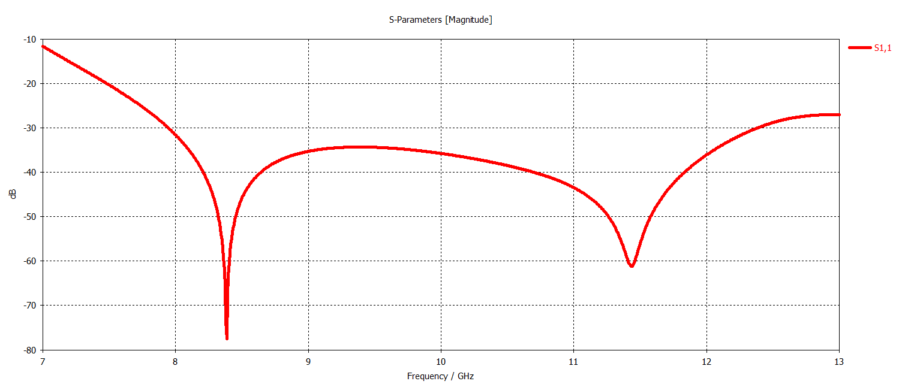
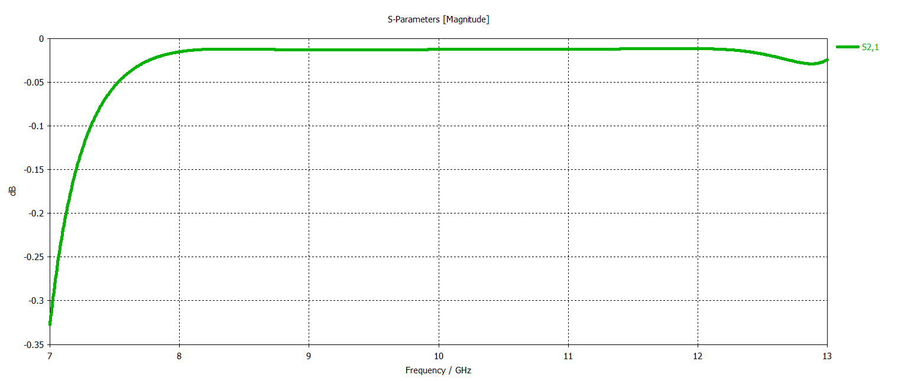
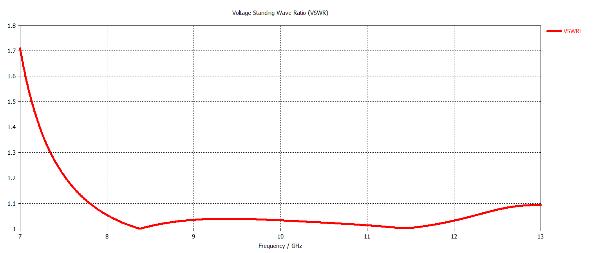

# WR90 Waveguide-to-Coax Adapter

## Overview

This design presents a WR90 waveguide-to-coax adapter developed and analyzed using CST Studio Suite.

The adapter provides a transition between a standard WR90 rectangular waveguide and a coaxial interface. A probe-type coaxial excitation is introduced into the waveguide section through an SMA connector in order to efficiently couple electromagnetic energy between the coaxial TEM mode and the dominant rectangular-waveguide mode.

The design includes a flange-mounted SMA connector and its detailed mechanical geometry. The electromagnetic performance was evaluated in terms of input matching, transmission characteristics and VSWR.

## Key Features

- **Simulation Tool:** CST Studio Suite
- **Component Type:** Waveguide-to-Coax Adapter
- **Waveguide Standard:** WR90
- **Coaxial Interface:** SMA
- **Connector Type:** 4-Hole Flange SMA Connector
- **Transition Type:** Right Angle
- **Main Performance Parameters:** S11, S21 and VSWR
- **Dominant Waveguide Mode:** TE10

## Waveguide Geometry

## Connector Geometry

<table>
<tr>
<td align="center">
  
</td>
<td align="center">
  
</td>
</tr>
</table>

## Reflection Coefficient

## Transmission Coefficient

## VSWR

